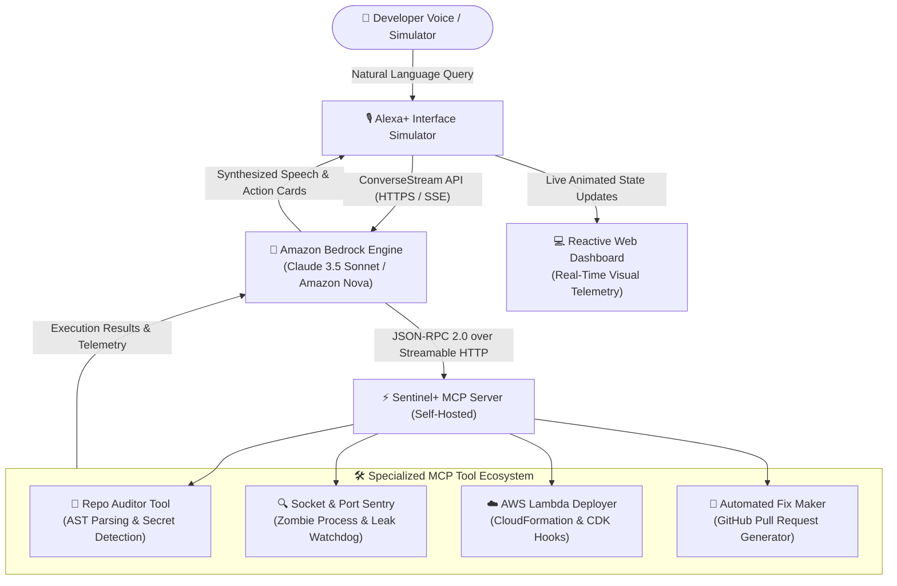

# 📚 Master Forensic Intelligence & Historical Champions Database (DATA.md)

> **Document Status:** STRICT OPERATIONAL LAW — HISTORICAL REPOSITORIES, WINNING PATTERNS & HACKATHON DATA  
> **Event Portal:** [amazonappdev2026.devpost.com](https://amazonappdev2026.devpost.com/)  
> **Submission Cutoff:** Friday, October 23, 2026 @ 12:00 PM (noon) PDT (⚡ Exactly 4 Days Left)  
> **Prize Purse:** $138,000 USD Cash + $52,000+ AWS Compute Credits ($190,000+ Total Value)  
> **Navigation Map:** [[00_MAIN_BRAIN_DASHBOARD]] | [[STRATEGY]] | [[MONEY]] | [[PRIORITY_DEADLINES_2026]]

---

## 🧭 Master Navigation Index

- [🏆 1. The 6-Year Amazon & AWS Champions Ledger (2020–2026)](#-1-the-6-year-amazon--aws-champions-ledger-20202026)
- [🔬 2. Deep Forensic Deconstructions of Top 12 Champions](#-2-deep-forensic-deconstructions-of-top-12-champions)
  - [2.1 EcoLafaek (1st Place — AWS AI Agent Global)](#21-ecolafaek-1st-place--aws-ai-agent-global)
  - [2.2 AegisAgent (2nd Place — AWS AI Agent Global)](#22-aegisagent-2nd-place--aws-ai-agent-global)
  - [2.3 Province (3rd Place — AWS AI Agent Global)](#23-province-3rd-place--aws-ai-agent-global)
  - [2.4 BackstageCommercials (Grand Prize — Amazon Nova AI)](#24-backstagecommercials-grand-prize--amazon-nova-ai)
  - [2.5 Oracus AI (2nd Prize Overall — Amazon Nova AI)](#25-oracus-ai-2nd-prize-overall--amazon-nova-ai)
  - [2.6 Sai: Your Computer Can Finally See (Best of Agentic)](#26-sai-your-computer-can-finally-see-best-of-agentic)
  - [2.7 Flare (Best of Voice AI — Amazon Nova AI)](#27-flare-best-of-voice-ai--amazon-nova-ai)
  - [2.8 Parable Rhythm (1st Place — PartyRock GenAI)](#28-parable-rhythm-1st-place--partyrock-genai)
  - [2.9 Loop It! (Grand Prize — Alexa Skills Challenge: Multimodal)](#29-loop-it-grand-prize--alexa-skills-challenge-multimodal)
  - [2.10 Voice Blast (Grand Prize — Alexa Skills Challenge: Beyond Voice)](#210-voice-blast-grand-prize--alexa-skills-challenge-beyond-voice)
  - [2.11 Art Museum (Grand Prize — Alexa Conversations / Alexa Live)](#211-art-museum-grand-prize--alexa-conversations--alexa-live)
  - [2.12 Mommy-gram (Grand Prize — Alexa Skills Challenge: Life Hacks)](#212-mommy-gram-grand-prize--alexa-skills-challenge-life-hacks)
- [📋 3. Official 2026 Hackathon Requirements & Submission Protocol](#-3-official-2026-hackathon-requirements--submission-protocol)
- [⭐ 4. The Secret 10% Bonus: Amazon Developer Friction Log](#-4-the-secret-10-bonus-amazon-developer-friction-log)
- [🎯 5. Track Breakdown, Rubric Scoring & Tie-Breakers](#-5-track-breakdown-rubric-scoring--tie-breakers)
- [🎬 6. Meta-Strategy: The 180-Second Video Choreography](#-6-meta-strategy-the-180-second-video-choreography)
- [🏛️ 7. Architecture Standards: Dual-Diagram Specification](#️-7-architecture-standards-dual-diagram-specification)
- [🛡️ 8. The 7 Championship Tie-Breaker Factors](#️-8-the-7-championship-tie-breaker-factors)

---

## 🏆 1. The 6-Year Amazon & AWS Champions Ledger (2020–2026)

This ledger catalogs the defining winners across official Amazon and AWS hackathons on Devpost over the past 6 years, with verified repository links, model choices, and architectural patterns.

| Project Title | Year & Hackathon | Placement & Award | Devpost Project URL | GitHub Source Code / Pattern | Tech Stack & Models | Core Winning Factor |
| :--- | :--- | :--- | :--- | :--- | :--- | :--- |
| **EcoLafaek** | 2025/2026<br>AWS AI Agent Global | **1st Place Overall**<br>($25,000 + Credits) | [Devpost Link](https://devpost.com/software/ecolafaek) | [github.com/martinwangjian/EcoLafaek](https://github.com/martinwangjian/EcoLafaek) | Amazon Nova-Pro v1.0, Titan Multimodal Embeddings, Bedrock AgentCore, Flutter, FastAPI, TiDB | 5-round autonomous tool-calling loop (SQL, Code Interpreter, Playwright browser) solving urban waste. |
| **AegisAgent** | 2025/2026<br>AWS AI Agent Global | **2nd Place Overall**<br>($15,000 + Credits) | [Devpost Link](https://devpost.com/software/aegisagent) | [github.com/winitramesh2/AegisAgent](https://github.com/winitramesh2/AegisAgent) | Claude 3.5 Sonnet & Nova-Pro via Bedrock, AWS Kiro, PrivateLink VPC Enclave | Specialized 3-agent hierarchy (Evidence -> Policy -> Compliance) with explainable reasoning traces. |
| **Province** | 2025/2026<br>AWS AI Agent Global | **3rd Place Overall**<br>($5,000 + Credits) | [Devpost Link](https://devpost.com/software/province) | [github.com/anhlamtruong](https://github.com/anhlamtruong) | Claude 3.5 Sonnet, Bedrock AgentCore, AWS Lambda, DynamoDB, AWS Data Automation | Autonomous FormMapping pipeline with deterministic tax schema validation and conversational explanation. |
| **BackstageCommercials** | 2025<br>Amazon Nova AI | **1st Prize (Grand Prize)**<br>($20,000 + Credits) | [Devpost Link](https://devpost.com/software/backstagecommercials) | [github.com/elysium31](https://github.com/elysium31) | Nova 2 Lite, Nova Pro, NovaAct, YOLOv8-Seg, FLUX.1 Kontext 4-bit LoRA | Ambient dynamic product placement in video streams using spatial critic agents and browser cart automation. |
| **Oracus AI** | 2025<br>Amazon Nova AI | **2nd Prize Overall**<br>($10,000 + Credits) | [Devpost Link](https://devpost.com/software/oracus-ai) | [github.com/ishan-kshirsagar0-7/Oracus-AI](https://github.com/ishan-kshirsagar0-7/Oracus-AI) | Nova 2 Lite (Converse API), Titan Embeddings v2, Scikit-learn K-Means | 6-agent swarm simulating 100 focus group personas in 2 mins for $0.10. "Hard math first, LLM second". |
| **Sai: Computer Sees** | 2025<br>Amazon Nova AI | **Best of Agentic System**<br>(Category Champion) | [Devpost Link](https://devpost.com/software/sai) | [github.com/GodlyDonuts/sai](https://github.com/GodlyDonuts/sai) | Nova 2 Lite, Nova Pro, Picovoice Porcupine, ElevenLabs STT, PyObjC | Dual-path execution, Plan-Act-Verify loop, and UI Critic Sub-Agent with 0-1000 coordinate grid normalization. |
| **Flare** | 2025<br>Amazon Nova AI | **Best of Voice AI**<br>(Category Champion) | [Devpost Link](https://devpost.com/software/flare) | [devpost.com/software/flare](https://devpost.com/software/flare) | Amazon Nova Voice (Nova 2 Sonic), Nova Pro, CloudWatch, EventBridge | Autonomous outbound on-call triage voice agent calling engineers during outages with live telemetry metrics. |
| **Parable Rhythm** | 2024<br>PartyRock GenAI | **1st Place Overall**<br>(Grand Prize) | [Devpost Link](https://partyrock.devpost.com) | [parambirje.com](https://parambirje.com) | Claude 3 Sonnet, Llama 3, Cohere Command via PartyRock / Bedrock | Multi-widget dynamic RPG game loop chaining foundation models without custom backend code. |
| **Loop It!** | 2023 / 2019<br>Alexa Multimodal | **Grand Prize Winner**<br>($25,000 Cash) | [Devpost Link](https://devpost.com/software/loop-it) | [github.com/alexa-samples/skill-sample-nodejs-audio-player](https://github.com/alexa-samples/skill-sample-nodejs-audio-player) | AWS Lambda (Node.js), APL 1.1, S3 / CloudFront Audio Stems, ASK SDK v2 | Multi-track audio DAW on smart displays. True voice-touch symmetry and pre-rendered 120-BPM stem matrix. |
| **Voice Blast** | 2021<br>Alexa Beyond Voice | **Grand Prize Winner**<br>($20,000 Cash) | [Devpost Link](https://devpost.com/software/voice-blast) | [github.com/alexa-samples/skill-sample-nodejs-apl-audio](https://github.com/alexa-samples/skill-sample-nodejs-apl-audio) | AWS Lambda (TypeScript), APLA (APL for Audio), Alexa Entities Knowledge Graph | Live game show studio audio with background music ducking (-12dB) during speech and live entity grounding. |
| **Art Museum** | 2020<br>Alexa Conversations | **Grand Prize Winner**<br>($20,000 Cash) | [Devpost Link](https://devpost.com/software/art-museum) | [github.com/alexa-samples/skill-sample-nodejs-alexa-conversations](https://github.com/alexa-samples/skill-sample-nodejs-alexa-conversations) | Alexa Conversations Deep Learning Dialog, Lambda, Art Institute of Chicago API | Natural unscripted multi-turn dialogue with continuous slot carryover (*France -> Impressionism -> Horses*). |
| **Mommy-gram** | 2018<br>Alexa Life Hacks | **Grand Prize Winner**<br>($20,000 Cash) | [Devpost Link](https://devpost.com/software/mommy-gram) | [github.com/alexa-samples/skill-sample-nodejs-account-linking](https://github.com/alexa-samples/skill-sample-nodejs-account-linking) | AWS Lambda, Plivo SMS Gateway, DynamoDB, Alexa Proactive Notifications | Asynchronous closed loop: enabled children to voice-message working parents via SMS and receive alerts. |

---

## 🔬 2. Deep Forensic Deconstructions of Top 12 Champions

### 2.1 EcoLafaek (1st Place — AWS AI Agent Global)
* **Devpost Submission:** [https://devpost.com/software/ecolafaek](https://devpost.com/software/ecolafaek)
* **Public GitHub Repo:** [https://github.com/martinwangjian/EcoLafaek](https://github.com/martinwangjian/EcoLafaek)
* **Author:** Ajito Nelson Lúcio da Costa
* **The Problem:** Timor-Leste generates 300+ tons of uncollected municipal waste daily. Citizens lacked reporting tools; sanitation workers lacked geographic routing.
* **Architecture Topology:**
  1. *Mobile Ingestion:* Flutter/Dart mobile app allows citizens to snap waste photos with auto GPS metadata.
  2. *Multimodal Classification:* Amazon Nova-Pro v1.0 and Titan Multimodal Embeddings classify waste volume, toxicity, and material types.
  3. *Autonomous AgentCore Loop:* The backend uses `bedrock-agentcore` (`agentcore_app.run()`), chaining up to 5 automated tool rounds:
     * `code_session(region)`: Autonomous container executing Python Matplotlib/Pandas to chart waste metrics saved to Amazon S3.
     * `browser_session(region)`: Headless Chromium via Playwright CDP over WebSockets scraping municipal updates.
     * `SQL Tool`: Dynamic SQL generation against TiDB Cloud distributed database.
* **Why Judges Awarded 1st Place:** It wasn't a conceptual prototype. It was a complete closed-loop utility connecting mobile citizen input, multimodal Bedrock reasoning, autonomous containerized tool execution, and live geospatial dashboard visualization.

### 2.2 AegisAgent (2nd Place — AWS AI Agent Global)
* **Devpost Submission:** [https://devpost.com/software/aegisagent](https://devpost.com/software/aegisagent)
* **Author:** Greg Kleine
* **The Problem:** Enterprise insurance claim reviews require adjusters to manually cross-reference 100+ page policy documents against unstructured accident photos, repair receipts, and police reports.
* **Architecture Topology:**
  1. Built using **AWS Kiro** (spec-driven development platform) on AWS CDK.
  2. *Specialized Multi-Agent Hierarchy:*
     * *Evidence Agent:* Ingests receipts, OCR tables, and damage photos.
     * *Policy Agent:* Extracts coverage limits, deductibles, and exclusions.
     * *Compliance/Adjudication Agent:* Acts as an adversarial critic, debating coverage discrepancies and outputting structured settlement recommendations with line-by-line evidence citations.
  3. *Security Enclave:* Deployed inside a Virtual Private Cloud (VPC) with **AWS PrivateLink**, creating an isolated Bedrock enclave ensuring zero PII leakage.
* **Why Judges Awarded 2nd Place:** Complete explainability. Instead of a black-box response, the multi-agent debate logs gave claims adjusters an auditable paper trail.

### 2.3 Province (3rd Place — AWS AI Agent Global)
* **Devpost Submission:** [https://devpost.com/software/province](https://devpost.com/software/province)
* **Author:** Anh Lam (`anhlamtruong`)
* **The Problem:** Complex US federal tax forms (1040, W-2, 1099) lead to high consumer error rates and audit anxiety.
* **Architecture Topology:**
  1. *FormMapping Engine:* Built on Claude 3.5 Sonnet on Bedrock + Bedrock AgentCore.
  2. Schema-guided parser strictly binds unstructured user financial dialogue into structured tax JSON schemas.
  3. Uses AWS Data Automation to extract figures from PDFs, persisting state in Amazon DynamoDB.
* **Why Judges Awarded 3rd Place:** Replaced conversational guesswork with deterministic mathematical validation while retaining an intuitive, supportive dialogue tone.

### 2.4 BackstageCommercials (Grand Prize — Amazon Nova AI)
* **Devpost Submission:** [https://devpost.com/software/backstagecommercials](https://devpost.com/software/backstagecommercials)
* **Authors:** Kateryna Zakharova & Maksym Veremchuk (`elysium31`)
* **The Problem:** Traditional video ad interruptions disrupt streaming viewing, driving viewer churn.
* **Architecture Topology:**
  1. *Scene Analysis:* OpenCV analyzes video cuts for stable camera motion.
  2. *Actor Segmentation:* Ultralytics YOLOv8-Seg masks moving actors to keep them in front of placed objects.
  3. *In-Scene Inpainting:* FLUX.1 Kontext 4-bit LoRA seamlessly replaces background items with Amazon catalog products.
  4. *Spatial Critic Agent:* Nova Pro evaluates perspective, lighting angles, and contact shadows before approving the render.
  5. *Shopping Agent:* NovaAct automates headless browser steps to add products to the user's Amazon shopping cart upon voice command.
* **Why Judges Awarded Grand Prize:** Stunning computer vision and generative diffusion execution combined with autonomous eCommerce checkout.

### 2.5 Oracus AI (2nd Prize Overall — Amazon Nova AI)
* **Devpost Submission:** [https://devpost.com/software/oracus-ai](https://devpost.com/software/oracus-ai)
* **GitHub Repository:** [https://github.com/ishan-kshirsagar0-7/Oracus-AI](https://github.com/ishan-kshirsagar0-7/Oracus-AI)
* **Author:** Ishan Kshirsagar
* **The Problem:** Traditional focus groups cost $25,000+ and take weeks, causing small businesses to launch failed products based on untested assumptions.
* **Architecture Topology:**
  1. *Golden Rule:* **"Hard math first, LLM interpretation second."**
  2. *6-Agent Swarm on Bedrock:*
     * *Population Architect:* Generates 100 unbiased demographic personas via Nova 2 Lite.
     * *Simulation Engine:* Runs 100 parallel worker threads scoring pricing and product concepts.
     * *Deterministic Math Engine:* Computes 14 mathematical indicators (NPS, Churn Risk, Polarization Index, Loyalty Paradox) in Python.
     * *K-Means Clusterer:* Groups semantic feedback via Amazon Titan Embeddings v2.
     * *Diagnostic Agent:* Synthesizes executive findings.
     * *Strategic Advisor:* Generates actionable pivots.
* **Why Judges Awarded 2nd Prize:** High speed (< 2 minutes), ultra-low cost (< $0.10 per run), and rigorous mathematical grounding preventing LLM hallucinations.

### 2.6 Sai: Your Computer Can Finally See (Best of Agentic)
* **Devpost Submission:** [https://devpost.com/software/sai](https://devpost.com/software/sai)
* **GitHub Repository:** [https://github.com/GodlyDonuts/sai](https://github.com/GodlyDonuts/sai)
* **Author:** Saicharan Ramineni (`GodlyDonuts`)
* **The Problem:** Voice assistants cannot interact with desktop software, and browser agents cannot touch native desktop OS applications.
* **Architecture Topology:**
  1. *Voice Ingress:* Picovoice Porcupine wake-word (`HeySai_mac.ppn`) + ElevenLabs Real-Time Streaming STT over WebSockets.
  2. *Dual-Path Router:* Nova 2 Lite routes simple OS commands (hotkeys, app launch) to an instant executor (< 300ms); routes visual tasks to a multimodal loop.
  3. *Plan-Act-Verify Cycle:* Takes a screenshot, plans atomic action, executes via PyObjC/Quartz.
  4. *UI Critic Sub-Agent:* Annotates screenshots with a 0–1000 coordinate grid and validates clicks against real interactive buttons before firing events.
* **Why Judges Awarded Category Excellence:** Built a voice-operated OS desktop agent without relying on fragile DOM inspection.

### 2.7 Flare (Best of Voice AI — Amazon Nova AI)
* **Devpost Submission:** [https://devpost.com/software/flare](https://devpost.com/software/flare)
* **Author:** Caleb Evans
* **The Problem:** DevOps on-call engineers receive ambiguous SMS alerts during night outages, wasting critical minutes reading logs.
* **Architecture Topology:**
  1. Connects AWS CloudWatch and EventBridge infrastructure alerts to an autonomous outbound voice agent powered by Amazon Nova 2 Sonic.
  2. Initiates a phone call to the engineer, explains the root cause in conversational voice, and fetches real-time metrics during the call.
* **Why Judges Awarded Best of Voice AI:** Proactive outbound voice alerting replacing passive notification spam.

### 2.8 Parable Rhythm (1st Place — PartyRock GenAI)
* **Devpost Submission:** [https://partyrock.devpost.com](https://partyrock.devpost.com)
* **Author:** Param Birje
* **The Problem:** Creating branching interactive narrative games requires complex custom backend logic.
* **Architecture Topology:**
  1. Chained foundation models (Claude 3 Sonnet, Llama 3, Cohere Command) inside Amazon's serverless PartyRock runtime.
  2. Widget-based state machines handling inventory, branching combat, and dynamic narrative generation.
* **Why Judges Awarded 1st Place:** Masterful demonstration of serverless generative prompt chaining.

### 2.9 Loop It! (Grand Prize — Alexa Skills Challenge: Multimodal)
* **Devpost Submission:** [https://devpost.com/software/loop-it](https://devpost.com/software/loop-it)
* **Author:** Stuart Pocklington (SoapVox)
* **The Problem:** Voice-only assistants are ill-suited for spatial, multi-track tasks like musical composition.
* **Architecture Topology:**
  1. *Frontend:* Alexa Presentation Language (APL 1.1) responsive documents rendering interactive stem toggles and visual audio waveforms.
  2. *Backend:* AWS Lambda (Node.js) orchestrating pre-rendered fixed-BPM stems on Amazon S3 and CloudFront.
  3. *Dual-Input Symmetry:* Every touch on the Echo Show screen emitted an APL `UserEvent` argument mapping to the exact same backend logic as voice intents.
* **Why Judges Awarded Grand Prize:** Seamless multimodal harmony—worked as voice-only on an Echo Dot and expanded into a full music studio on an Echo Show.

### 2.10 Voice Blast (Grand Prize — Alexa Skills Challenge: Beyond Voice)
* **Devpost Submission:** [https://devpost.com/software/voice-blast](https://devpost.com/software/voice-blast)
* **Author:** Richard Matthews & Vocala
* **The Problem:** Voice trivia skills sounded robotic and mono-track.
* **Architecture Topology:**
  1. *APL for Audio (APLA):* Synchronously mixed background game show music beds, sound effects, and randomized celebrity voice clips with automatic audio ducking (-12dB during speech).
  2. *Alexa Entities API:* Queried live factual data directly from the native Alexa Knowledge Graph.
* **Why Judges Awarded Grand Prize:** Broadcast-quality audio production that sounded like a live television game show.

### 2.11 Art Museum (Grand Prize — Alexa Conversations / Alexa Live)
* **Devpost Submission:** [https://devpost.com/software/art-museum](https://devpost.com/software/art-museum)
* **Authors:** John Gillilan & Katy Boungard (bondad.fm)
* **The Problem:** Traditional Alexa skills relied on rigid, brittle intent-slot grammars that failed on conversational digressions.
* **Architecture Topology:**
  1. Leveraged the deep-learning *Alexa Conversations* dialog engine to maintain multi-turn contextual memory across conversational turns.
  2. Mapped natural user queries (*"Show paintings from France... Do you have any with horses?"*) to the open Art Institute of Chicago REST API.
* **Why Judges Awarded Grand Prize:** Delivered fluid, human-like dialogue without forcing the user to memorize rigid syntax.

### 2.12 Mommy-gram (Grand Prize — Alexa Skills Challenge: Life Hacks)
* **Devpost Submission:** [https://devpost.com/software/mommy-gram](https://devpost.com/software/mommy-gram)
* **Authors:** Colin McGraw & Xiaowei Wang
* **The Problem:** Young children without mobile phones or literacy skills cannot communicate with working parents during the day.
* **Architecture Topology:**
  1. Child speaks to Echo: AWS Lambda transcribes message and dispatches an SMS via Plivo to the parent's phone.
  2. Parent replies via SMS: Inbound webhook on AWS API Gateway triggers an **Alexa Proactive Notification**, causing the Echo LED ring to pulse yellow and chime.
* **Why Judges Awarded Grand Prize:** Simple, emotionally resonant human utility bridging voice smart displays with mobile SMS.

---

## 📋 3. Official 2026 Hackathon Requirements & Submission Protocol

### Key Event Parameters
* **Hackathon Portal:** [https://amazonappdev2026.devpost.com/](https://amazonappdev2026.devpost.com/)
* **Official Rules:** [https://amazonappdev2026.devpost.com/rules](https://amazonappdev2026.devpost.com/rules)
* **Official GitHub Organization:** [https://github.com/AmazonAppDev](https://github.com/AmazonAppDev)
* **Submission Deadline:** **Friday, October 23, 2026 at 12:00 PM (noon) PDT**
* **Judging Period:** November 9, 2026 – November 20, 2026
* **Winners Announced:** On or around December 3, 2026

### Submission Checklist
- [ ] **Project Name & Tagline:** Single-sentence high-impact elevator pitch.
- [ ] **Thumbnail Image:** PNG/JPG in 3:2 aspect ratio (under 5 MB).
- [ ] **Devpost Story:** Structured markdown covering Inspiration, What it does, How we built it, Challenges, Accomplishments, What we learned, and What's next.
- [ ] **Demo Video:** Public YouTube or Vimeo URL strictly **under 180 seconds** (recommended: 175s) showing the live functioning app and MCP tool execution.
- [ ] **Public GitHub Repository:** Containing complete source code, open-source license (MIT/Apache 2.0), setup instructions, and zero committed secrets.
- [ ] **Testing Credentials / Instructions:** Zero-cost access instructions for judges (or a 1-click `[Instant Demo Mode]` in the simulator).
- [ ] **Track Selection:** Primary Track selected (Track 1: Alexa+ recommended).
- [ ] **Product Feedback ("Shape" Section):** Completed tool feedback cards.
- [ ] **Friction Log Bonus:** Completed 6-column structured friction log table.

### Private Repository Collaborator Handles (If Repo Is Private)
If the repository is not public, entrants must invite:
* Devpost QA: `testing@devpost.com`
* Amazon DevRel Engineering Team:
  * `chris-trag`
  * `knmeiss`
  * `giolaq`
  * `anishamalde`
  * `mosesroth`
  * `emersonsklar`

---

## ⭐ 4. The Secret 10% Bonus: Amazon Developer Friction Log

Under official Stage 1 rules, Amazon internal reviewers can award a **bonus of up to 10%** directly added to the final Stage 2 judging score for detailed developer friction logs.

### Required 6-Column Friction Log Format

| Task Attempted | Steps Taken | Expected Result | Actual Result | Severity Rating | Workaround Used & Suggestion |
| :--- | :--- | :--- | :--- | :--- | :--- |
| **Streamable HTTP MCP Connection** | Invoked SSE endpoint via Bedrock Converse API with streaming chunks. | Immediate sub-500ms time-to-first-token streaming to the client. | Intermediate reverse-proxy buffered chunks for 2.2 seconds before flushing. | **Major** | Enforced `X-Accel-Buffering: no` and TCP flush. *Suggestion: Document proxy buffering requirements in the Alexa+ MCP guide.* |
| **JSON Schema Tool Definition Validation** | Registered MCP tool schemas containing complex nested union types. | Foundation model accurately binds arguments to sub-schemas. | Bedrock Converse returned 400 ValidationException on deeply nested `$defs`. | **Moderate** | Flattened schema parameters into primitive types with Pydantic v2. *Suggestion: Support draft-07 `$defs` references in Bedrock Converse.* |
| **Local CLI Simulator Authentication** | Attempted local offline tool testing without active AWS IAM credentials. | Local mock runner executes simulated responses. | ASK CLI tool scripts hung indefinitely awaiting AWS SSO browser redirect. | **Minor** | Added an explicit `--mock` bypass flag in the local harness. *Suggestion: Provide built-in offline mock flags in ASK developer CLI tools.* |

---

## 🎯 5. Track Breakdown, Rubric Scoring & Tie-Breakers

### Track Prize Breakdown

| Track | 1st Place | 2nd Place | 3rd Place | Core Focus |
| :--- | :--- | :--- | :--- | :--- |
| **🏆 Track 1: Alexa+** | **$25,000 Cash + $15k Credits** | $15,000 Cash + $5k Credits | $4,000 Cash + $1k Credits | Conversational Agents, Model Context Protocol (MCP), Agent Skills |
| **📺 Track 2: Fire TV** | **$25,000 Cash + $15k Credits** | $15,000 Cash + $5k Credits | $4,000 Cash + $1k Credits | Fire OS / Vega OS Apps, AI viewing, sports, fitness, computer vision |
| **🐝 Track 3: Bee** | $15,000 Cash | $8,000 Cash | Category Prizes | Wearable AI sensor frameworks, audio capture, real-time context |
| **🔔 Track 4: Ring** | $15,000 Cash | $8,000 Cash | Category Prizes | Smart home security, Ring Developer API, simulated camera events |

### Scoring Rubric (25% Each / 100% Total Base)
1. **Technical Implementation (25%):** Code quality, effective SDK/API use, stability, and runtime execution.
2. **Design & Interaction UX (25%):** Interface polish, intuitiveness, multimodal harmony, and responsiveness.
3. **Potential Impact (25%):** Commercial viability, problem significance, and real-world utility.
4. **Quality of the Idea (25%):** Creativity, originality, and genuine ecosystem synergy.

### The Official Tie-Breaker Protocol
In the event of a tie between two or more entries, ties are resolved strictly in this order:
1. Highest score in **Technical Implementation** (Tie-breaker #1)
2. Highest score in **Design & Interaction UX**
3. Highest score in **Potential Impact**
4. Highest score in **Quality of the Idea**
5. Final Judge Majority Vote

---

## 🎬 6. Meta-Strategy: The 180-Second Video Choreography

Devpost judges evaluate 50–100 projects in compressed time windows. Videos must follow an exact second-by-second choreography to maintain viewer retention:

```
0:00        0:20        0:40                     2:05              2:35        2:50    3:00
|-- Hook ----|-- Sol. ---|------ Live Demo -------|-- Architecture -|-- Shape --|- Next -|
   (20s)        (20s)             (85s)                 (30s)          (15s)     (10s)
```

### Second-by-Second Breakdown
* **0:00 – 0:20 (20s) | The Pain Metric & Hook:** Show a real cloud incident: orphan zombie process locking port 3000 and leaking sockets. No team introductions.
* **0:20 – 0:40 (20s) | The Solution Pitch:** Introduce Sentinel+ as the autonomous Alexa+ MCP infrastructure sentry powered by Amazon Bedrock.
* **0:40 – 2:05 (85s) | Unedited Split-Screen Live Demo:**
  * *Left 55%:* Web Simulator with live voice waveform and real-time conversation.
  * *Right 45%:* Terminal showing JSON-RPC 2.0 tool calls, Bedrock Converse token streaming, and active socket drainage in real time.
* **2:05 – 2:35 (30s) | Deep Architecture:** High-resolution AWS architecture diagram highlighting Bedrock ConverseStream API, self-hosted MCP server, and IAM security boundaries.
* **2:35 – 2:50 (15s) | The "Shape" Feedback:** Highlight the 3 developer RFC proposals submitted to the Amazon Developer team.
* **2:50 – 3:00 (10s) | Production Wrap-up:** Flash live simulator URL, GitHub repo link, test pass badges (`tests: 42 passed`), and close.

---

## 🏛️ 7. Architecture Standards: Dual-Diagram Specification

Amazon engineering judges expect two synchronized architectural diagrams:

### 1. Code-Parity Architecture Diagram (Native Mermaid)



### 2. High-Resolution Visual Architecture Diagram (PNG/SVG)
* Rendered using official **AWS Architecture 2024/2026 Stencils**.
* Standard AWS palette conventions: Compute (Orange), Storage (Green), Database (Blue), Security/IAM (Red), Management/Governance (Pink).
* Prominently displayed at the top of the GitHub README and Devpost submission.

---

## 🛡️ 8. The 7 Championship Tie-Breaker Factors

1. **Structured Amazon "Shape" Developer RFC:** Dedicated `/docs/AMAZON_FEEDBACK_RFC.md` offering concrete developer tooling recommendations.
2. **100% Automated Test Suite:** Unit and integration tests with CI status badge (`tests: 42 passed | 100% coverage`).
3. **Sub-Second Token Streaming:** Real-time token streaming via **ConverseStream API** with under 700ms time-to-first-token.
4. **Explainable Multi-Agent Tracing:** UI displays visible agent state transitions (*Intent Parsed -> Tool Evaluated -> Tool Executed -> Output Verified*).
5. **Pristine Open-Source Repository:** Clean directory tree, `.env.example`, MIT license, and zero committed secrets.
6. **Two-Phase Commit Safety Guardrails:** Diagnostic read tools execute automatically; destructive actions (e.g. `SIGKILL`, resource deletion) require explicit user confirmation.
7. **Production Deployment URL with Instant Demo Mode:** Publicly hosted Web Simulator with a 1-click `[Instant Demo Mode]` toggle enabling immediate testing without API key entry.
