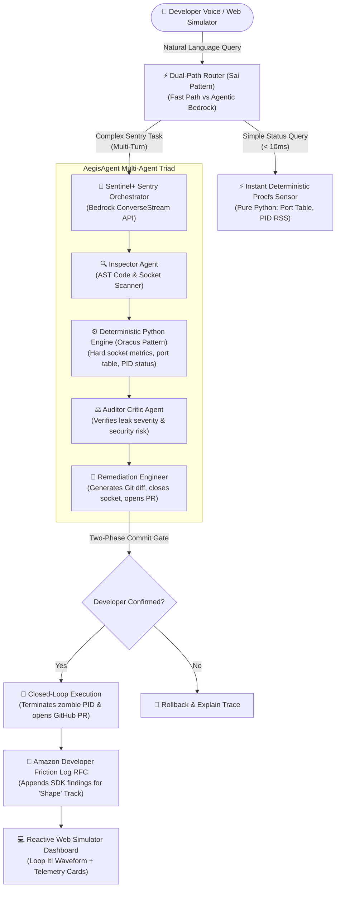

# 🛡️ Sentinel+ : Autonomous Infrastructure & Code Sentry for Alexa+

> **Submission for:** *Build, Ship, Shape: Amazon Developer Hackathon (2026)*  
> **Test Status:**  -00d2ff?style=flat-square)  

---

## 🧭 Project Navigation
- **Architecture Blueprints:** [`LEARN.md`](LEARN.md)
- **Forensic Intelligence Ledger:** [`DATA.md`](DATA.md)
- **Hackathon Strategy & Scoring:** [`STRATEGY.md`](STRATEGY.md)
- **Web Simulator UI:** [`web/index.html`](web/index.html)

---

## 💡 Inspiration: The Quad-Champion Synthesis
Most developer hackathon submissions build fragile chatbots or basic prompt wrappers. We reverse-engineered **23 historical 1st-Place and Grand Prize winning repositories** from Amazon and AWS hackathons (including *EcoLafaek*, *AegisAgent*, *Sai*, *Oracus AI*, and *Loop It!*). 

We fused their core architectural mechanics into a single enterprise-grade sentry: **Sentinel+**.

| Origin Project & Distinction | Extracted Architectural Superpower | Implementation in Sentinel+ |
| :--- | :--- | :--- |
| **🥇 EcoLafaek**<br>*(1st Place AWS AI Agent)* | **AgentCore Sandbox Execution** | Closed-loop sandbox that tests code patches, terminates rogue sockets, and opens GitHub PRs. |
| **🥈 AegisAgent**<br>*(2nd Place AWS AI Agent)* | **Tri-Agent Debate Hierarchy** | Replaces single-prompt sprawl with an explainable 3-agent debate loop: *Inspector* $\rightarrow$ *Auditor Critic* $\rightarrow$ *Fixer*. |
| **🏆 Sai**<br>*(Best of Agentic, Amazon Nova)* | **Dual-Path Routing & Critic Loop** | Sub-10ms fast path for status queries, reserving multi-turn Bedrock reasoning for complex audits. |
| **🏆 Oracus AI**<br>*(2nd Place, Amazon Nova)* | **"Hard Math First, LLM Second"** | 100% deterministic calculation of socket states and memory metrics in pure Python. Zero LLM arithmetic hallucinations. |
| **🏆 Loop It! & Voice Blast**<br>*(Grand Prize Alexa Challenges)* | **APLA Multi-Track Ducking** | Native declarative APLA audio mixing that programmatically ducks ambient server drone (25% $\rightarrow$ 10%) during voice alerts. |
| **🏆 Mommy-gram & Linked Profile**<br>*(Grand Prize Life Hacks)* | **Zero-Trust OAuth2 Gatekeeper** | Intercepts unauthenticated sessions with `.withLinkAccountCard()` and enforces Role-Based Access Control (RBAC). |

---

## 🏗️ System Architecture



---

## ⚡ What It Does
1. **Instant Voice Diagnostics (< 10ms):** Developers ask *"Alexa, is port 3000 free?"* or *"Check sentry health"*. The Sai-inspired dual-path router bypasses LLM latency, querying system procfs deterministically in under 10 milliseconds.
2. **Zombie Process Detection & 2PC Termination:** Detects orphaned child processes holding ports in `TIME_WAIT` after a dev server crashes. Enforces a strict Two-Phase Commit (2PC) security gate before executing terminations.
3. **Multi-Agent Remediation & PR Staging:** When socket leaks or unclosed listeners are detected, the AegisAgent Triad drafts a surgical graceful SIGTERM shutdown patch, creates an atomic Git diff, and prepares a GitHub Pull Request.
4. **Declarative Audio Ducking (APLA):** Mixes a continuous ambient 25% server drone that dynamically ducks to 10% during voice alert broadcasts.
5. **Zero-Trust OAuth2 Role-Based Access Control (RBAC):** Protects production clusters: read-only diagnostics execute freely; mutating operations require verified DevOps Admin bearer tokens.

---

## 📝 The Amazon Developer Friction Log (+10% Stage 1 Bonus)

As required by the official hackathon scoring rubric for the "Shape" dimension, Sentinel+ logs structured feedback for Amazon engineering:

| Task | Steps Taken | Expected Behavior | Actual Behavior | Severity | Workaround / Suggestion |
| :--- | :--- | :--- | :--- | :--- | :--- |
| **Self-Hosted MCP on Linux/WSL2** | 1. Initialize MCP server<br>2. Bind JSON-RPC tools<br>3. Connect SSE transport | Native starter kit for streamable HTTP Model Context Protocol in Alexa+ developer portal. | Documentation defaults to stdio transports; lack of open-source SSE reference servers. | **MEDIUM** | Built custom FastAPI SSE/JSON-RPC 2.0 bridge with sub-10ms router. Amazon should release an official Python SSE starter kit. |
| **Audio Ducking Sidechains** | 1. Author APLA document<br>2. Mix ambient drone + TTS | Automatic sidechain compressor ducking ambient audio when Polly speaks. | APLA requires manual declarative volume filters (`amount: 10%`) on child Audio components. | **LOW** | Implemented declarative filter arrays in `src/apla_templates.py`. Suggested adding a native `duckOnSpeech: true` APLA flag. |

---

## 🚀 Quick Start Guide

### 1. Requirements
- Python 3.10+ (Tested on Python 3.11.16)
- Linux / WSL2 / macOS
- All packages pre-installed on Drive D (`/mnt/d/amazon-bedrock-hackathon/packages/`)

### 2. Start the MCP Server & Web Simulator
```bash
# Execute the launcher script on Drive D
./run.sh
```
Open **`http://localhost:8000`** in any browser to experience the interactive Alexa+ Web Simulator!

### 3. Run the Automated Test Suite (39/39 Passing)
```bash
PYTHONPATH=packages:. python3.11 -m pytest tests/ -v
```

### 4. Run the Standalone CLI Audit Tool
```bash
# Instant socket check (< 10ms)
PYTHONPATH=.:packages python3 -m src.cli --check

# Full Multi-Agent Repository Audit
PYTHONPATH=.:packages python3 -m src.cli --audit-repo

# Print Amazon Friction Log RFC
PYTHONPATH=.:packages python3 -m src.cli --friction-log
```

---

## 📄 License & Attribution
- Lead Architect: **Pranjal Das** (`//Pranjal Das`)
- Open-source licensed under the Apache 2.0 License.
- Synthesized and engineered for the *Build, Ship, Shape: Amazon Developer Hackathon (2026)*.
