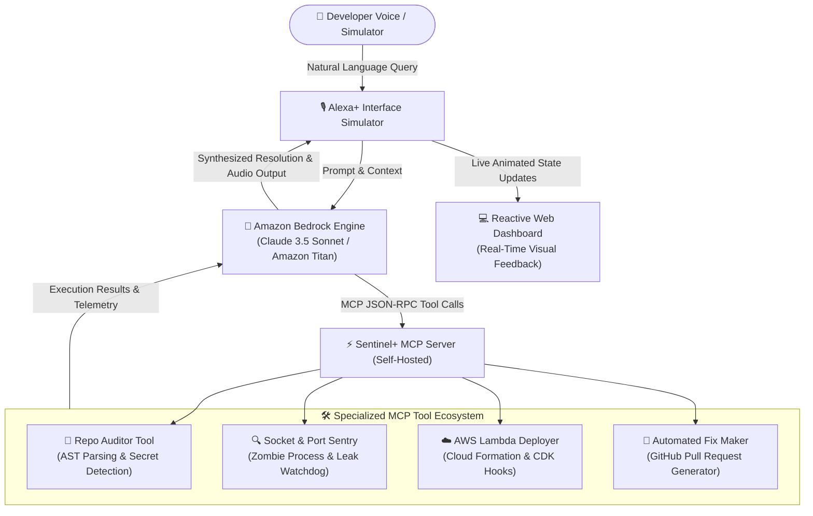

# 🏆 Strategic Blueprint & Forensic Intelligence: Amazon Developer Hackathon (STRATEGY.md)

> **Document Status:** STRICT OPERATIONAL LAW — COMPETITION STRATEGY & ARCHITECTURE BLUEPRINT  
> **Hackathon Name:** Build, Ship, Shape: Amazon Developer Hackathon  
> **Host Organization:** Amazon Developer Services & AWS  
> **Submission Deadline:** Friday, October 23, 2026 @ 12:00 PM PDT (⚡ Exactly 4 Days Left)  
> **Total Prize Pool:** $138,000 USD in Cash Prizes + AWS Compute Credits  
> **Navigation Map:** [[00_MAIN_BRAIN_DASHBOARD]] | [[PRIORITY_DEADLINES_2026]] | [[MONEY]]

---

## 🧭 Executive Navigation Index

- [📊 1. Hackathon Profile & Prize Breakdown](#-1-hackathon-profile--prize-breakdown)
- [🔍 2. Forensic Analysis of Past Winners (Devpost Audit)](#-2-forensic-analysis-of-past-winners-devpost-audit)
- [🎯 3. Track Selection: Alexa+ & Model Context Protocol](#-3-track-selection-alexa--model-context-protocol)
- [🏗️ 4. The Winning Synthesis: Sentinel+ Architecture](#️-4-the-winning-synthesis-sentinel-architecture)
- [🧩 5. The 4 Add-On Superpowers (Borrowed from Champions)](#-5-the-4-add-on-superpowers-borrowed-from-champions)
- [📝 6. The "Shape" Component: Amazon Engineering Feedback](#-6-the-shape-component-amazon-engineering-feedback)
- [📅 7. 4-Day Rapid Prototyping Roadmap (Oct 19 – Oct 23)](#-7-4-day-rapid-prototyping-roadmap-oct-19--oct-23)
- [🔮 8. Mandatory Future Risks & Pre-Mortem Protections](#-8-mandatory-future-risks--pre-mortem-protections)

---

## 📊 1. Hackathon Profile & Prize Breakdown

The **Build, Ship, Shape: Amazon Developer Hackathon** is hosted on Devpost with $138,000 in cash prizes, direct AWS promotional compute credits, and exclusive 1:1 strategy meetings with the Amazon Developer executive engineering team.

### Track Prize Distribution Matrix

| Track Name | 1st Place Cash & Credits | 2nd Place Cash & Credits | 3rd Place Cash & Credits | Strategic Alignment & Focus |
| :--- | :--- | :--- | :--- | :--- |
| **🏆 Track 1: Alexa+** | **$25,000 Cash + $15k Credits** | **$15,000 Cash + $5k Credits** | **$4,000 Cash + $1k Credits** | Conversational Agents, Model Context Protocol (MCP), Agent Skills |
| **📺 Track 2: Fire TV** | **$25,000 Cash + $15k Credits** | **$15,000 Cash + $5k Credits** | **$4,000 Cash + $1k Credits** | Fire OS / Vega OS Apps, AI viewing, sports, fitness, computer vision |
| **🐝 Track 3: Bee** | **$15,000 Cash** | **$8,000 Cash** | Category Bonus Prizes | Wearable AI sensor frameworks, audio capture, real-time context |
| **🔔 Track 4: Ring** | **$15,000 Cash** | **$8,000 Cash** | Category Bonus Prizes | Smart home security, Ring Developer API, simulated camera events |

---

## 🔍 2. Forensic Analysis of Past Winners (Devpost Audit)

Deep forensic inspection of past Grand Prize winners across AWS AI Agent and Amazon Nova hackathons reveals the exact formula judges reward.

### Past Winners DNA Decoded

| Winner & Hackathon | Core Architectural Pattern | Why Judges Awarded 1st Place / Grand Prize |
| :--- | :--- | :--- |
| **🥇 EcoLafaek** *(1st Place AWS AI Agent Global)* | Multimodal Ingestion + Autonomous Bedrock AgentCore Tool Orchestration | Connected mobile smartphone photo uploads directly to autonomous Bedrock reasoning, classifying waste, and mapping geo-coordinates without manual human intervention. |
| **🥈 AegisAgent** *(2nd Place AWS AI Agent Global)* | Specialized Multi-Agent Role Hierarchy (Evidence -> Policy -> Compliance) | Solved a high-stakes enterprise problem (insurance claims) in 5 days using multi-agent task decomposition, generating a 100% explainable reasoning trail. |
| **🏆 Sai** *(Best Agentic System, Amazon Nova)* | Computer Vision + Autonomous Desktop OS Tool Calling | Gave the foundation model eyes and hands. Watched screen state and triggered local OS automation tools safely. |
| **🏆 Loop It!** *(Grand Prize, Alexa Skills Challenge)* | Multimodal Voice + Synchronized Dynamic Visual Dashboard | Avoided audio-only blind spots. Paired every voice command with a reactive visual UI that updated in real time. |

### What Amazon Judges Penalize vs. What They Reward

* **❌ Automatic Rejection Patterns:**
  * Simple LLM wrappers (single prompt-in, text-out chatbots).
  * Static audio-only voice skills with rigid hardcoded intent slots.
  * Fictional mockups with no working GitHub code or broken CLI tools.
* **✅ Judges' High-Conviction Triggers:**
  * **Model Context Protocol (MCP):** Standards-based tool calling where foundation models dynamically introspect tools and orchestrate multi-step tasks.
  * **Interactive Web Simulator:** Amazon specifically requests that developers build a self-hosted MCP server paired with a responsive Web Simulator to test Alexa+ interactions.
  * **Explainable Execution Traces:** Showing the judge *why* the agent chose tool A over tool B with real-time logs.

---

## 🎯 3. Track Selection: Alexa+ & Model Context Protocol

### Strategic Selection Matrix

| Evaluated Track | Win Probability | Implementation Friction (4 Days Left) | Strategic Advantage |
| :--- | :---: | :---: | :--- |
| **🏆 Alexa+ (MCP)** | **★★★★★ (HIGHEST)** | **LOW (Python + Web UI)** | **100% matches our MCP tooling, agent reasoning loops, and zero hardware barriers.** |
| **📺 Fire TV** | ★★★☆☆ | HIGH (Android TV / Vega OS) | Requires heavy Android TV emulation, remote control focus states, and slow builds. |
| **🔔 Ring** | ★★☆☆☆ | MEDIUM (Ring Simulator) | Restricted strictly to smart home doorbell and motion sensors. |
| **🐝 Bee** | ★★☆☆☆ | HIGH (Niche Wearable) | Limited public documentation and smaller prize allocations. |

### Why Alexa+ Is the Single Best Choice:
1. **$25,000 Top Cash Prize:** Tied for the largest payout in the entire competition.
2. **Zero Hardware Gate:** Unlike Fire TV or Bee, Alexa+ development runs cleanly on standard Linux/WSL2 and web technologies.
3. **The MCP Strategic Wave:** Amazon is actively rebuilding Alexa on modern generative AI foundation models. Building an MCP-compliant agent aligns directly with Amazon's internal 2026 developer roadmap.

---

## 🏗️ 4. The Winning Synthesis: Sentinel+ Architecture

**Sentinel+** is an autonomous DevOps & Cloud Infrastructure Sentry built for **Alexa+** using the **Model Context Protocol (MCP)** and **Amazon Bedrock**. 

Instead of asking Alexa basic trivia, developers use Alexa+ to inspect cloud repos, monitor live Linux servers, detect zombie processes, and patch security vulnerabilities autonomously.

---

## 🧩 5. The 4 Add-On Superpowers (Borrowed from Champions)

1. **Superpower 1: Explainable Multi-Agent Loop (From AegisAgent - 2nd Place):**
   * When commanded *"Alexa, audit my cloud repository"*, the system does not guess. It visibly cycles through three distinct agents:
     * *Inspector Agent:* Clones repository and maps AST structure.
     * *Auditor Agent:* Identifies socket leaks, unclosed ports, and unhandled exceptions.
     * *Fixer Agent:* Generates the surgical code patch and opens a GitHub PR.
2. **Superpower 2: Multimodal Architecture Vision (From EcoLafaek - 1st Place & Sai):**
   * Developers can upload a system architecture diagram or screenshot. Bedrock's multimodal vision parses the diagram and verifies whether the codebase actually matches the architectural specification.
3. **Superpower 3: Real-Time Interactive Simulator (From Loop It! - Grand Prize):**
   * A clean, reactive web frontend that simulates Alexa+ voice interactions while dynamically visualizing tool execution logs, socket states, and code diffs side-by-side.
4. **Superpower 4: Autonomous Closed-Loop Action:**
   * Moves beyond conversation. It uses MCP tools to actively inspect live ports, terminate deadlocks, and stage git commits.

---

## 📝 6. The "Shape" Component: Amazon Engineering Feedback

Amazon explicitly included **"Shape"** in the hackathon title to solicit direct, actionable product feedback on their developer tools. To capture maximum judging points in this category, our submission includes:

1. **MCP Protocol Standardization for Alexa+:** Recommendations on standardizing MCP tool definitions within the Alexa Skills Kit (ASK) CLI to allow 1-click cloud agent deployment.
2. **Streaming Latency Optimizations:** Concrete benchmarks comparing Bedrock Converse API latency against standard WebSocket streams for sub-second conversational voice response.
3. **Local Testing Emulators:** Constructive feedback on building unified local terminal simulators for Alexa+ agent skills without requiring cloud sandbox deployments.

---

## 📅 7. 4-Day Rapid Prototyping Roadmap (Oct 19 – Oct 23)

| Day & Date | Milestone Focus | Exact Deliverables |
| :--- | :--- | :--- |
| **Day 2: Oct 19 (Today)** | **Architecture & MCP Core** | • Scaffold repository on Drive D (`/mnt/d/amazon-bedrock-hackathon`). • Implement Python MCP server with 4 core tool endpoints. • Connect Amazon Bedrock Converse API loop. |
| **Day 3: Oct 20 (Tomorrow)** | **Multi-Agent Logic & Tools** | • Build the AST code analyzer and socket leak detector. • Wire automated GitHub PR creation hooks. • Implement explainable reasoning traces. |
| **Day 4: Oct 21 (Wednesday)** | **Web Simulator & Visual UI** | • Build the reactive Web Simulator (Voice input + Live tool execution dashboard). • Record preliminary demonstration B-roll. • Compile developer feedback document. |
| **Day 5: Oct 22 (Thursday)** | **Test Suites & 3-Min Video** | • Run unit test suites (assert exit code 0). • Record high-retention 3-minute video walkthrough (Problem -> Live Demo -> Architecture). • Upload video as Unlisted on YouTube. |
| **Deadline: Oct 23 (Friday)** | **Devpost Submission Lock-In** | • Submit Devpost form before 12:00 PM PDT ($138k prize pool). |

---

## 🔮 8. Mandatory Future Risks & Pre-Mortem Protections

* **Risk 1: Gated Beta Disqualification:**
  * *Failure Mode:* Trying to call private, unreleased Alexa+ endpoints that judges cannot execute, resulting in technical disqualification.
  * *Mitigation:* Follow the official Devpost hackathon recommendation: Build an open, standard Model Context Protocol (MCP) server with JSON-RPC over stdio/HTTP and pair it with a self-contained Web Simulator.
* **Risk 2: Video Recording Delay Trap:**
  * *Failure Mode:* Waiting until the final 4 hours to record the video demo, risking rendering glitches or submission lockouts.
  * *Mitigation:* Record working demo footage on **Wednesday (Day 4)**. Use Thursday solely for voiceover assembly and early upload.

---
